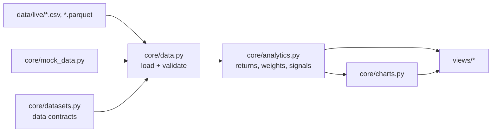

# NFTrinity Dashboard

Streamlit dashboard for the Public Portfolio, Content and Research workflows, built for PMs to read
at a glance. It runs on deterministic mock data until live files are dropped into `data/live/`;
see the [Data Handbook](docs/DATA_HANDBOOK.md).

## Run

```powershell
uv venv .venv --python 3.12
uv pip install --python .venv\Scripts\python.exe -r requirements.txt
.venv\Scripts\python.exe -m streamlit run app.py
```

Open http://localhost:8501.

## Pages

| Section | Page | File |
|---|---|---|
| Public Portfolio | Live Portfolio | `views/portfolio/live_portfolio.py` |
| | Decision Date | `views/portfolio/decision_date.py` |
| | Portfolio (TBD) | `views/portfolio/portfolio_tbd.py` |
| | Pro Forma | `views/portfolio/pro_forma.py` |
| | Agent Suggestions | `views/portfolio/agent_suggestions.py` |
| Content | Slides & Charts | `views/content/slides_charts.py` |
| | Presentation | `views/content/presentation.py` |
| Research | Catalysts | `views/research/catalysts.py` |
| | Alternative Data | `views/research/alt_data.py` |
| | Prime Broker Positioning | `views/research/pb_positioning.py` |

## How the code fits together



- `core/datasets.py` defines the 14 input datasets: columns, types, ranges and keys.
- `core/data.py` loads each dataset from `data/live/` when a file exists, otherwise from mock data,
  and validates files against their contract.
- `core/analytics.py` calculates everything shown: returns, weights, contributions, decision
  outcomes, signals, catalyst timing and pre-trade checks.
- `core/charts.py` holds the Plotly chart builders, shared by the pages and the Slides & Charts library.
- `core/ui.py` holds the layout helpers. Headline numbers and card grids wrap to fit phone, tablet
  and desktop widths.
- `core/config.py` holds the benchmark name, pre-trade limits and the crowding threshold.
- `assets/` holds the NFTrinity logo: `logo-light.png`, `logo-dark.png` (light text for the dark
  theme) and `mark.png` (the favicon and collapsed-sidebar icon).

## Data

```powershell
.venv\Scripts\python.exe -m core.data validate    # check files in data/live/
.venv\Scripts\python.exe -m core.data templates   # rewrite data/templates/ from mock data
```

`data/templates/` has an example file for every dataset. `data/live/` is git-ignored: live
portfolio data never goes to GitHub.
