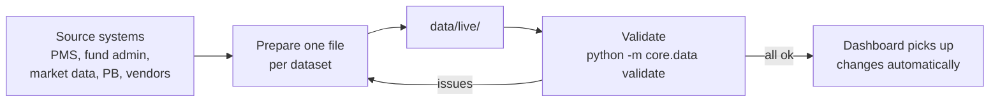

# Data Handbook

How to feed live data into the NFTrinity dashboard: what each page needs, the exact file format,
and how to prepare and check the files before the app uses them.

Until a file is provided, the app keeps showing mock data for that dataset, so live data can be
switched on one dataset at a time.

---

## 1. How data gets into the app



1. Prepare one file per dataset (section 4), named exactly `<dataset>.csv` or `<dataset>.parquet`,
   for example `data/live/positions.csv`.
2. Put the files in `data/live/` in the project folder.
3. Run the validator from the project root:

   ```powershell
   .venv\Scripts\python.exe -m core.data validate
   ```

4. Fix anything it reports, then refresh the browser. The app reloads a dataset whenever its file
   changes; no restart is needed.

`data/live/` is listed in `.gitignore`. Live portfolio data must never be committed to GitHub.

Every dataset has a ready-made example in `data/templates/`, in the exact column layout the app
expects. The quickest way to start is to copy a template and replace its rows.

### Other delivery routes

Files are the simplest starting point. The loader (`core/data.py`) can also read from a database
table or view with the same columns, for example in Snowflake, or from a shared drive. Send the
table names and connection details, and only the loader needs to change. The pages stay as they are.

---

## 2. Conventions that apply to every file

| Topic | Rule |
|---|---|
| Format | CSV (UTF-8, comma-separated, header row) or Parquet. One file per dataset. |
| Column names | Exactly as listed in section 4, lower case. Extra columns are ignored. |
| Dates | `YYYY-MM-DD`, e.g. `2026-10-21`. Timestamps: `YYYY-MM-DD HH:MM`. |
| Weights, returns, shares | Decimals, never percent: `0.05` means 5%. The validator flags values above 1 as a likely percent mistake. |
| Leverage | Decimal multiple of equity: `3.0` means 300% gross. |
| Percentiles | 0 to 100. |
| Currency | USD for every price, value and flow. |
| Tickers | One identifier style used everywhere (e.g. `NVDA`, or `NVDA US` if that is the house style). Every ticker in any file must also appear in `securities`. |
| Sectors | GICS sector short names: Info Tech, Comm Services, Cons Disc, Cons Staples, Energy, Financials, Health Care, Industrials, Materials, Real Estate, Utilities. |
| Missing values | Leave the cell empty. Never use `0`, `-` or `N/A` to mean unknown. |
| Refresh | Replace the whole file on each refresh. Time series files hold the full history, not just the latest day. |
| Timing | Daily files after the US close, so they are complete by the next morning. |

---

## 3. Which page uses which data

| Page | Datasets it reads | What the app calculates for you |
|---|---|---|
| **Live Portfolio** | positions, nav, prices, benchmark, benchmark_sectors, securities. The attention strip also reads pb_crowding, alt_data, agent_suggestions and decisions | Returns, weights, day P&L, sector bets, contributions, beta |
| **Decision Date** | decisions, positions, nav, prices, benchmark, securities | Return since each decision, value added vs benchmark, hit rate, book before/after |
| **Portfolio (TBD)** | None yet | |
| **Pro Forma** | positions, nav, prices, securities, benchmark_sectors, agent_suggestions | Pro forma weights, cash, beta, concentration, pre-trade checks, trade list |
| **Agent Suggestions** | agent_suggestions, plus positions, nav, prices for current weights | Weight change, how many signals support each idea |
| **Slides & Charts** | Whatever the chosen charts use; no extra data | |
| **Presentation** | Same as Slides & Charts | One-line takeaway per slide |
| **Alternative Data** | alt_data, securities, plus positions for our weights | Acceleration signal per name |
| **Prime Broker Positioning** | pb_leverage, pb_sectors, pb_sector_flows, pb_crowding, plus positions and benchmark_sectors for our exposure | Crowded-holding flags, our active weight per sector |

You never need to send returns, weights or P&L. The app derives them from positions, prices and
NAV, so all pages stay consistent with each other.

### Suggested rollout order

Every page reads our current weights, which come from positions, prices and NAV, and the sidebar
date comes from NAV. So the core book goes live first, and each later step adds one page.

| Step | Add these files | Pages that become fully live |
|---|---|---|
| 1. Core book | securities, prices, benchmark, benchmark_sectors, positions, nav | Live Portfolio (except the attention strip), Pro Forma |
| 2. Decisions | decisions | Decision Date |
| 3. Agent | agent_suggestions | Agent Suggestions |
| 4. Alt data | alt_data | Alternative Data |
| 5. PB data | pb_leverage, pb_sectors, pb_sector_flows, pb_crowding | Prime Broker Positioning, then the full attention strip |

Between steps, the pages not yet switched keep mock data, which uses mock tickers. Make sure
`securities` covers every ticker those mock files mention (see `data/templates/securities.csv`),
or switch the remaining datasets on together.

---

## 4. Dataset reference

Each section gives the purpose, a likely source, how often to refresh, the history needed, the
columns, and preparation notes. Key columns must be unique together: the validator rejects
duplicates.

### 4.1 `securities`: security master

The list of every name the app may show. Typical source: PMS or the data vendor's reference data.
Refresh when names are added. Key: `ticker`.

| Column | Type | Required | Notes |
|---|---|---|---|
| ticker | text | yes | Identifier used across every dataset |
| name | text | yes | Display name, e.g. `NVIDIA` |
| sector | text | yes | GICS sector short name (section 2) |
| beta | number | no | Beta vs benchmark. If blank, the app estimates it from one year of daily returns |

**Prepare:** include every ticker that appears in any other file: current and past holdings,
names in committee decisions and agent ideas, and names covered by alt data or PB crowding.

### 4.2 `prices`: daily closing prices

Typical source: Bloomberg, FactSet or the PMS price feed. Daily after the close. Key: `date, ticker`.
History: from the first position date (two years or more recommended).

| Column | Type | Required | Notes |
|---|---|---|---|
| date | date | yes | Trading day |
| ticker | text | yes | |
| close | number | yes | Close adjusted for splits and dividends, in USD |

**Prepare:** use adjusted closes, otherwise a split or dividend shows up as a fake loss. Convert
non-USD listings to USD at the same day's FX rate. One row per ticker per trading day; skip
holidays rather than repeating the prior close.

### 4.3 `benchmark`: benchmark index level

Typical source: index provider or Bloomberg. Daily. Key: `date`. Same history as prices.

| Column | Type | Required | Notes |
|---|---|---|---|
| date | date | yes | |
| level | number | yes | Total-return (gross or net dividends) index level |

**Prepare:** use the total-return version of the index so it is comparable with the portfolio.
Set the benchmark's display name in `core/config.py` (`BENCHMARK_NAME`).

### 4.4 `benchmark_sectors`: benchmark sector weights

Typical source: index provider factsheet or holdings. Monthly. Key: `sector`.

| Column | Type | Required | Notes |
|---|---|---|---|
| sector | text | yes | GICS sector short name |
| weight | number | yes | Decimal; all rows sum to 1 |

### 4.5 `positions`: end-of-day positions

Typical source: PMS/OMS or the fund administrator. Daily after the close. Key: `date, ticker`.
History: since inception, so performance and contributions cover every period on the page.

| Column | Type | Required | Notes |
|---|---|---|---|
| date | date | yes | Position date (end of day) |
| ticker | text | yes | |
| quantity | number | yes | Shares held at the close. The book is long-only, so 0 or more |
| avg_cost | number | no | Average cost per share in USD. Without it, "Since entry" and P&L columns are hidden |

**Prepare:** one row per held name per day; leave a name out on days it is not held. Quantities
are after that day's trades. Every (date, ticker) here needs a price on the same date.

### 4.6 `nav`: daily NAV and cash

Typical source: fund administrator or PMS. Daily after the close. Key: `date`. Same history as positions.

| Column | Type | Required | Notes |
|---|---|---|---|
| date | date | yes | Must cover every date in positions |
| nav | number | yes | Total NAV in USD, including cash |
| cash | number | yes | Cash balance in USD (negative if overdrawn) |
| flow | number | no | Net subscriptions (+) or redemptions (−) that day, USD |

**Prepare:** NAV should equal the market value of positions plus cash. Fill `flow` whenever money
moves in or out: the app removes flows from the daily return, so a subscription does not show up
as performance.

### 4.7 `decisions`: investment-committee decisions

Typical source: the committee's decision log, kept as a spreadsheet or in the OMS. Update after each
meeting. Key: `decision_date, ticker`.

| Column | Type | Required | Notes |
|---|---|---|---|
| decision_date | date | yes | Meeting date; trades assumed done at that day's close |
| ticker | text | yes | |
| action | text | yes | One of `Initiate`, `Add`, `Trim`, `Exit` |
| weight_before | number | yes | Weight on the day, before trading (decimal) |
| weight_after | number | yes | Target weight agreed (decimal); `0` for Exit |
| rationale | text | yes | One sentence on why |
| decided_by | text | no | e.g. `Investment Committee` |

**Prepare:** one row per name per meeting. Initiate means `weight_before` is 0; Exit means
`weight_after` is 0. The app measures each decision from the decision-day close to the latest close.

### 4.8 `agent_suggestions`: research agent trade ideas

Source: the research agent's output. Replace on each run. Key: `id`.

| Column | Type | Required | Notes |
|---|---|---|---|
| id | text | yes | Unique per idea, e.g. `S-101` |
| generated_at | timestamp | yes | When the run finished |
| ticker | text | yes | |
| action | text | yes | `Initiate`, `Add`, `Trim` or `Exit` |
| target_weight | number | yes | Target weight after the trade (decimal), not the change |
| confidence | number | yes | 0 to 1 |
| horizon | text | yes | Free text, e.g. `3-6 months` |
| sig_alt_data | integer | yes | +1 bullish, 0 neutral, −1 bearish |
| sig_pb_positioning | integer | yes | Same scale |
| sig_momentum | integer | yes | Same scale |
| sig_revisions | integer | yes | Same scale |
| sig_valuation | integer | yes | Same scale |
| rationale | text | yes | Bullet points separated by ` \| `, e.g. `Point one \| Point two` |

**Prepare:** signals record which way each signal points, not whether it agrees with the idea. The
app works out support itself: a bearish signal supports a Trim. If the file holds several runs,
only the latest day's run is shown.

Accept and Dismiss choices are currently kept for the browser session only. Saving them, or
sending accepted ideas to the OMS, is a later step.

### 4.9 `alt_data`: alternative data, YoY growth

Typical source: card-spend, app-analytics and web-traffic vendors. Weekly. Key: `week, ticker, metric`.
History: at least 17 weeks for the signal; two years for the charts.

| Column | Type | Required | Notes |
|---|---|---|---|
| week | date | yes | Week-ending date (Friday) |
| ticker | text | yes | |
| metric | text | yes | `Card spend`, `App MAU` or `Web visits` |
| yoy | number | yes | Year-over-year growth, decimal (`0.08` = +8%) |

**Prepare:** map each vendor's panel or app ID to our ticker before delivery. Send YoY growth, not
raw levels. A name can skip a metric it isn't covered on. The signal compares the latest 4-week
average with the 13 weeks before it: more than +1.5 pp is Accelerating, less than −1.5 pp
Decelerating. Adding a new metric needs a one-line code change; ask first.

### 4.10 `pb_leverage`: hedge-fund leverage

Source: prime broker weekly reports. Weekly. Key: `week`. History: three years, for the percentile.

| Column | Type | Required | Notes |
|---|---|---|---|
| week | date | yes | Report week |
| gross | number | yes | Gross leverage, decimal multiple (`3.0` = 300%) |
| net | number | yes | Net leverage, decimal (`0.75` = 75%) |

### 4.11 `pb_sectors`: hedge-fund sector positioning

Source: prime broker weekly reports. Latest week only. Key: `sector`.

| Column | Type | Required | Notes |
|---|---|---|---|
| as_of | date | yes | Report date |
| sector | text | yes | GICS sector short name |
| net_share | number | yes | Sector's share of hedge-fund net exposure, decimal |
| percentile_3y | number | yes | Today's net exposure as a percentile of its own 3-year history, 0 to 100 |
| change_4w | number | no | Four-week change in `net_share`, decimal |

**Prepare:** map the PB's sector names onto the GICS short names in section 2.

### 4.12 `pb_sector_flows`: hedge-fund sector flows

Source: prime broker weekly reports. Weekly. Key: `week, sector`. History: at least 12 weeks.

| Column | Type | Required | Notes |
|---|---|---|---|
| week | date | yes | |
| sector | text | yes | GICS sector short name |
| flow_z | number | yes | Net buying as a z-score against the past year (positive = buying) |

### 4.13 `pb_crowding`: single-stock crowding

Source: prime broker crowding reports, plus exchange short-interest data. Latest week only. Key: `ticker`.

| Column | Type | Required | Notes |
|---|---|---|---|
| as_of | date | yes | Report date |
| ticker | text | yes | |
| crowding_pct | number | yes | Hedge-fund long exposure as a percentile of its 3-year history, 0 to 100 |
| short_interest | number | yes | Share of float sold short, decimal |
| days_to_cover | number | yes | Short interest divided by average daily volume |
| flow_z | number | no | Week-over-week net buying z-score |

**Prepare:** cover at least every current holding. A holding counts as crowded at the 85th
percentile or above (`CROWDED_PCT` in `core/config.py`).

---

## 5. Checking the files

`python -m core.data validate` checks every file in `data/live/` and prints one line per dataset:

```text
  ok    positions          positions.csv, 9,880 rows
  FAIL  decisions          decisions.csv, 13 rows
          - weight_after: 2 value(s) above 1; check units (decimals, not percent)
          - 1 duplicate row(s) for key (decision_date, ticker)
  -     pb_crowding        not provided, app uses mock data
```

What it checks:

- required columns are present;
- values parse as the right type (dates, numbers);
- no blanks in required columns;
- values within range, which catches percent-vs-decimal mistakes;
- text values from the allowed lists (actions, sectors, metrics);
- no duplicate keys;
- every ticker exists in `securities`;
- every position has a price that day, and NAV covers every position date.

The app runs the same single-file checks when it loads a file. If a file fails, the page shows an
error listing the problems instead of wrong numbers. The cross-file checks (the last two bullets)
run only in the validator, so run it after every delivery.

---

## 6. Settings that live in code

`core/config.py` holds the settings that are decisions rather than data:

| Setting | Default | Used by |
|---|---|---|
| `BENCHMARK_NAME` | `Benchmark` | Chart legends |
| `LIMITS["max_position"]` | 10% | Pro Forma check, holdings weight bars |
| `LIMITS["min_cash"]`, `["max_cash"]` | 1%, 10% | Pro Forma check |
| `LIMITS["max_sector_active"]` | ±15 pp vs benchmark | Pro Forma check |
| `LIMITS["min_positions"]`, `["max_positions"]` | 15, 30 | Pro Forma check |
| `CROWDED_PCT` | 85 | Crowded flags on Live Portfolio and PB Positioning |

---

## 7. Open questions for the data owners

1. **Intraday prices.** "Live" currently means as of the last close. Real-time P&L needs an
   intraday price feed (e.g. Bloomberg B-PIPE or FactSet streaming).
2. **Benchmark.** Which index, and gross or net total return?
3. **Ticker convention.** Plain tickers, Bloomberg tickers, or another ID such as FIGI or ISIN?
4. **Decision log.** Where is it kept today, and who updates it after each meeting?
5. **Agent output.** Can the agent write `agent_suggestions` in this format directly? Should
   accepted ideas be saved, or sent to the OMS?
6. **Non-USD holdings.** Who supplies the FX rates, and should the app show local-currency returns?
7. **Delivery.** Files in `data/live/`, a shared drive, or database views such as Snowflake?
